# CMC Press Kit

Art and copy for the **Concise Mouse Consistency (CMC)** Nexus page. Everything here is loose files. Nothing is zipped.

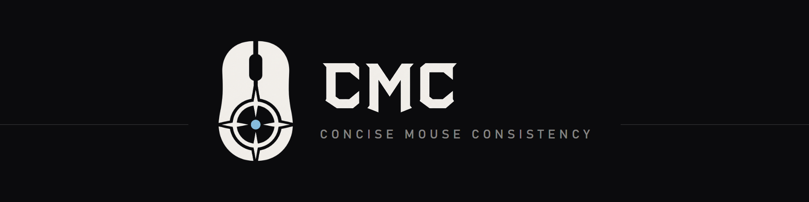

## Copy-paste text

| File | Paste into |
|---|---|
| [`nexus-description.bbcode.txt`](nexus-description.bbcode.txt) | Nexus **Description** field (BBCode). Images load from this repo's `main` branch. |
| [`nexus-summary.txt`](nexus-summary.txt) | Nexus **Brief overview** (under 255 characters) |

## Nexus permissions tab

CMC is **GPL-3.0-or-later** ([`LICENSE`](../LICENSE)). The GPL already grants these permissions and forbids adding restrictions (GPL-3 §10), so every Nexus toggle is **allowed, with the GPL conditions**:

| Nexus permission | Setting |
|---|---|
| Upload permission | Allowed to upload to other sites, with credit |
| Modification permission | Allowed to modify and release, with credit |
| Conversion permission | Allowed to convert to other games, with credit |
| Asset use permission | Allowed to use in other mods, with credit |
| Asset use in mods/files being sold | Allowed (choosing "No" would add a restriction the GPL forbids) |
| Asset use in mods/files earning Donation Points | Allowed |
| Donation Points for this mod | Your choice |

Custom permission instructions:

```text
Concise Mouse Consistency is free software, licensed GPL-3.0-or-later (https://www.gnu.org/licenses/gpl-3.0.html).
You may re-upload, modify, translate, port and include it in other works, provided that:
- your version is also licensed GPL-3.0-or-later,
- you provide the complete corresponding source code (or a link to it) with any binary you distribute,
- you keep the copyright and license notices and credit the original author.
Source code: https://github.com/Kexodus/concise-mouse-consistency-cmc
```

Credits (the "Credits" text box):

```text
SKSE team: SKSE64
meh321: Address Library for SKSE Plugins
Ryan McKenzie, CharmedBaryon, alandtse and contributors: CommonLibSSE-NG
Thiago099 and QTR-Modding: SKSE Menu Framework
spdlog, fmt, xbyak, rapidcsv, DirectXMath, DirectXTK
```

The GPL source obligation is met by the public repository and its release tags, which the description links to. The release ZIP stays DLL + INI only.

## Nexus page images

Upload these on the Nexus **Images** tab. Set the thumbnail as the mod's **Primary image**; Nexus uses that image for the mod tile in search and browse.

| Image | Size | Use |
|---|---|---|
| [`cmc-thumbnail-1280x720.png`](nexus/cmc-thumbnail-1280x720.png) | 1280×720 | **Nexus thumbnail** (set as Primary image). Centered logo only, readable at tile size and safe under center crops. |
| [`cmc-primary-1920x1080.png`](nexus/cmc-primary-1920x1080.png) | 1920×1080 | Gallery: logo and full name |
| [`cmc-gallery-look-speed-1920x1080.png`](nexus/cmc-gallery-look-speed-1920x1080.png) | 1920×1080 | Gallery: vanilla vs CMC look speed |
| [`cmc-gallery-features-1920x1080.png`](nexus/cmc-gallery-features-1920x1080.png) | 1920×1080 | Gallery: the four things CMC fixes |
| [`cmc-header-1920x480.png`](nexus/cmc-header-1920x480.png) | 1920×480 | Description banner / page header |

<p>
  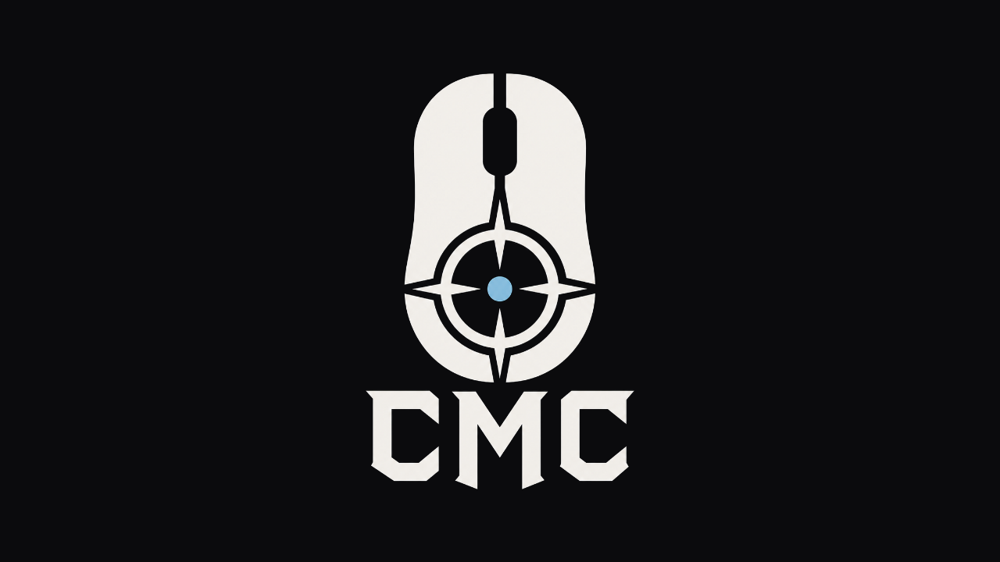
  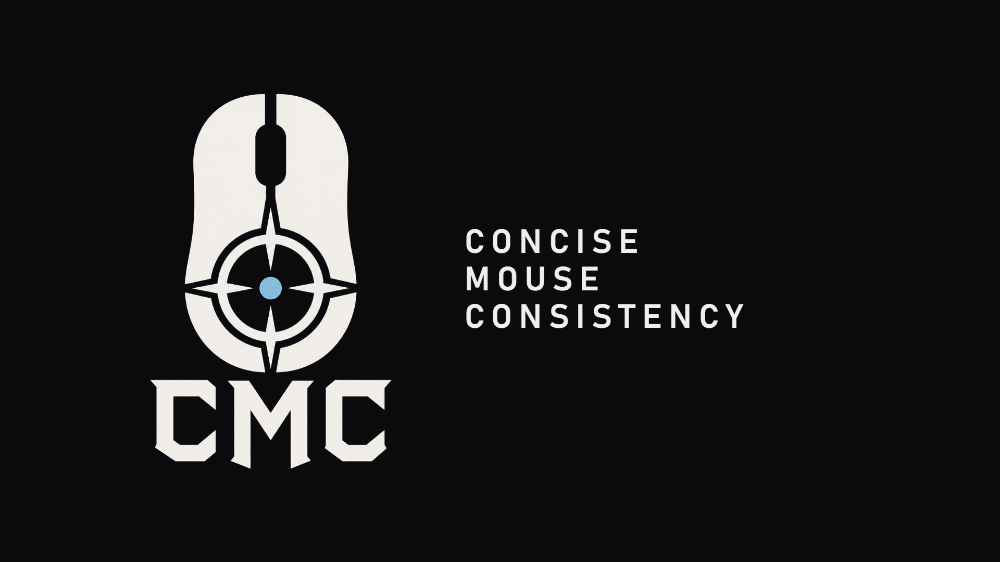
  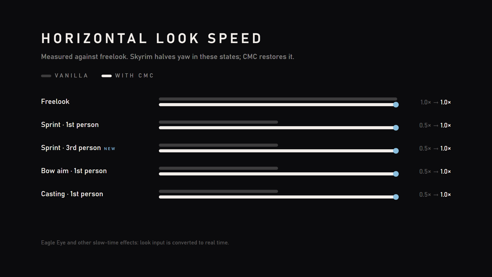
  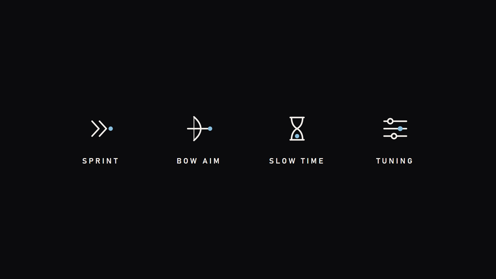
</p>

## Description images

The BBCode file already uses these, in the same section order as the IHarvest NG page. Each sits in a rounded card with a faint edge and a soft shadow, on a transparent PNG, so it blends into the Nexus page. The gallery uploads above stay full-bleed.

| Image | Size |
|---|---|
| [`desc-header.png`](nexus/desc-header.png) | 1920×528 |
| [`desc-look-speed.png`](nexus/desc-look-speed.png) | 1920×1128 |
| `section-*.png` | 1200×136 |
| [`cmc-divider-1200x48.png`](nexus/cmc-divider-1200x48.png) | 1200×48, mark only |

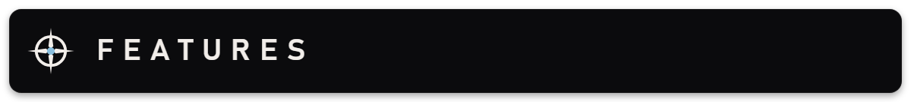
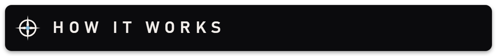
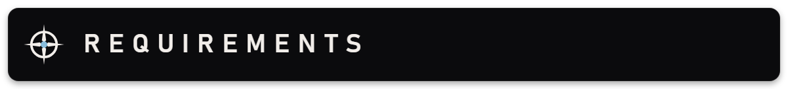
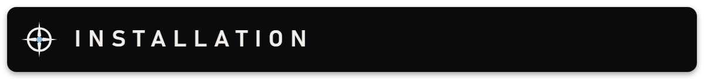
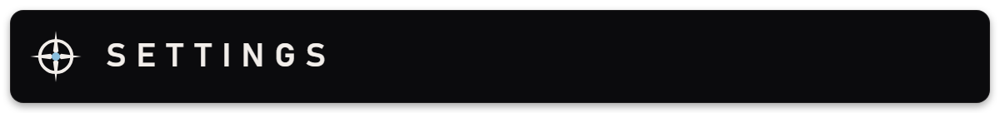
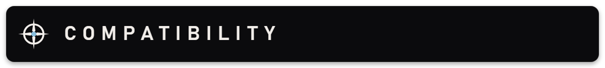
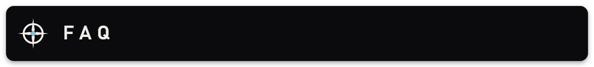
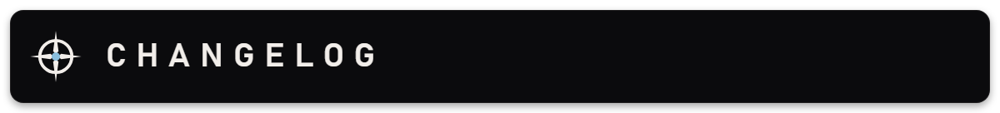
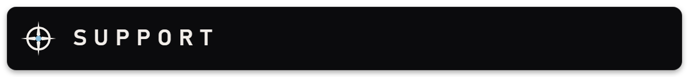
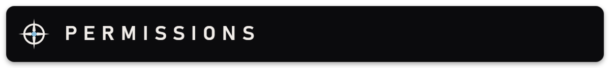
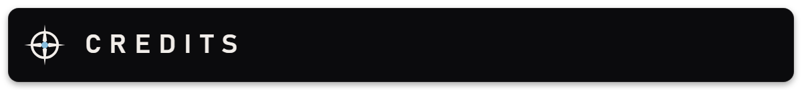


## Logo files

| File | Notes |
|---|---|
| [`logo/cmc-logo-1254.png`](logo/cmc-logo-1254.png) | Original minimal logo on black |
| [`logo/cmc-logo-512.png`](logo/cmc-logo-512.png), [`logo/cmc-logo-256.png`](logo/cmc-logo-256.png) | Avatar / icon sizes |
| [`logo/cmc-logo-transparent.png`](logo/cmc-logo-transparent.png) | Full logo, transparent background |
| [`logo/cmc-emblem-transparent.png`](logo/cmc-emblem-transparent.png) | Mouse and reticle only |
| [`logo/cmc-wordmark-transparent.png`](logo/cmc-wordmark-transparent.png) | "CMC" lettering only |

The transparent files are light artwork. Place them only on dark backgrounds.

## Style

| Token | Value | Use |
|---|---|---|
| Background | `#0b0b0d` | Every canvas |
| Foreground | `#f2eeea` | Logo, headings, body text (55% opacity for secondary text) |
| Accent | `#89bedd` | Reticle dot. Use it for one detail per image at most. |
| Type | Bahnschrift (Windows) | Uppercase headings with wide letter spacing |

Keep it flat: no gradients, glows, textures, or extra colors. One idea per image, no taglines or spec badges. The reticle mark in the section headers is redrawn from the logo.

## Rebuild

Requires Windows, Python 3 with Pillow, and Microsoft Edge.

```powershell
python presskit/src/cutout.py   # logo/ cutouts from assets/cmc-nexus-logo-v2-minimal.png
python presskit/src/build.py    # nexus/ images rendered with headless Edge
```

Image copy lives in `presskit/src/build.py`. Change the text there, rebuild, and commit the PNGs. Nexus loads the description images from `main`.
